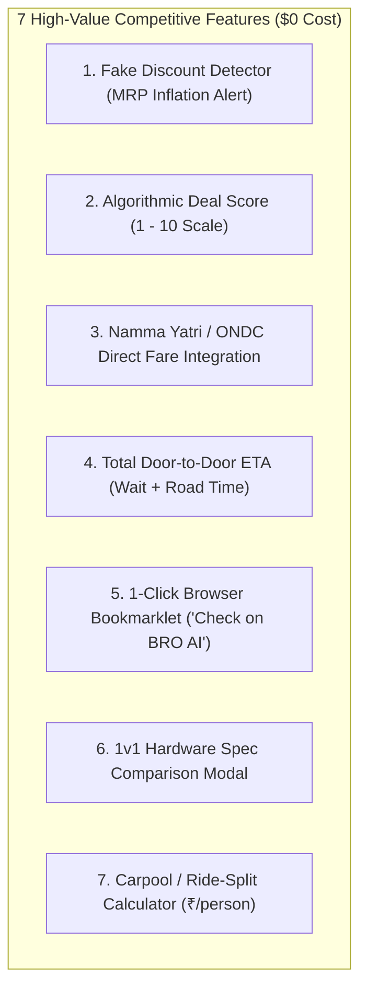

# BRO AI Platform — Comprehensive Master Improvisation Plan (improvise.md)

> **Document Type:** Global Competitive Analysis & Technical Implementation Specification  
> **Target Project:** `bro-web` (React 19, Tailwind CSS v4, Vite, Supabase Cloud PostgreSQL, OpenStreetMap/OSRM)  
> **Status:** AI-Executable Engineering Roadmap  
> **Cost Guarantee:** 100% Zero-Cost Architecture ($0.00/month out of pocket)

---

## 1. Global & Indian Competitive Intelligence

To understand where BRO AI stands and what must be added to make it superior to existing platforms, we analyzed the top applications on the internet across both verticals:

### A. Electronics Price Tracking & Arbitrage
- **Competitors Analyzed:** *Smartprix*, *Buyhatke*, *PriceHistory.app*, *Keepa*, *CamelCamelCamel*, *MySmartPrice*.
- **Their Strengths:**
  1. **Fake Discount Detection:** Exposing sellers who artificially inflate MRP before a sale (e.g. marking ₹24,999 up to ₹29,999 to claim a "fake 20% discount").
  2. **Algorithmic Deal Score (1–10):** A single instant number telling the user how good the current price is compared to all-time low and all-time high.
  3. **1-Click Browser Bookmarklet / Extension:** A zero-install browser button allowing users on Amazon/Flipkart to inspect price history immediately.
  4. **Side-by-Side 1v1 Spec Comparison:** Comparing two phones or laptops side-by-side with a specs score.

### B. Real-Time Cab & Mobility Comparison
- **Competitors Analyzed:** *Comparify*, *Buyhatke Ride Compare*, *ChooseApp*, *Rido*, *Migo*, *Namma Yatri*.
- **Their Strengths:**
  1. **Namma Yatri / ONDC Open Mobility Integration:** India's open-network auto app with 0% driver commission, offering the cheapest auto rides in Bangalore, Delhi, Kochi, and Kolkata.
  2. **Total Door-to-Door ETA (Pickup Wait Time + Road Travel Time):** Comparing not just the fare, but the total time to arrival:
     $$\text{Total Time} = \text{Driver Pickup ETA} + \text{OSRM Road Duration}$$
  3. **Ride-Split / Carpool Fare Calculator:** Showing per-person cost for groups (e.g. ₹110/person for 3 people).
  4. **Direct Intent Geo Deep Links:** Pre-populating exact latitude and longitude in Uber, Ola, and Rapido apps.

---

## 2. Competitive Gap Analysis & Zero-Cost Technical Blueprints

All 7 gap features identified from the best apps on the web can be implemented in BRO AI with **zero paid APIs ($0.00 cost)** using client-side algorithms, OpenStreetMap, and Supabase:



---

### GAP 1: Fake Discount Detector & MRP Inflation Alert
- **Problem:** Sellers on Amazon and Flipkart inflate the MRP right before Diwali, Independence Day, or Big Billion Days sales to claim a false 25%–40% discount.
- **Zero-Cost Algorithm:**
  - Compare current price against the 30-day moving average from Supabase `public.price_history`:
    $$\text{Real Discount \%} = \frac{\text{30-Day Avg Price} - \text{Current Price}}{\text{30-Day Avg Price}} \times 100$$
  - If retailer claims 25% off, but Real Discount is $\le 2\%$:
    - Display an amber warning badge on `ProductDetailModal.jsx`:  
      ⚠️ **Artificial Discount Detected:** Retailer raised MRP by ₹4,000. Real discount is only 1.8% vs normal price.
  - If Real Discount is $> 8\%$:
    - Display an emerald badge:  
      ✅ **Genuine Deal Verified:** Price is ₹2,100 lower than the 30-day average.

---

### GAP 2: Algorithmic Deal Score (1 to 10 Scale)
- **Problem:** Users experience decision fatigue reading raw numbers across 3 stores.
- **Zero-Cost Algorithm:**
  - Query all-time low ($P_{\min}$) and all-time high ($P_{\max}$) from `public.price_history`:
    $$\text{Deal Score} = \text{round}\left(10 \times \left(1 - \frac{P_{\text{current}} - P_{\min}}{P_{\max} - P_{\min}}\right), 1\right)$$
  - Renders a prominent score on every product card:
    - **9.0 – 10.0:** 🏆 **God-Tier Deal** (Buy immediately)
    - **7.0 – 8.9:** 🟢 **Good Value** (Below average price)
    - **5.0 – 6.9:** 🟡 **Average Price** (Standard retail tariff)
    - **< 5.0:** 🔴 **Overpriced** (Wait for weekend drop)

---

### GAP 3: Namma Yatri / ONDC Open Mobility Integration
- **Problem:** Rapido and Uber take 20%–25% commission from drivers, making auto fares higher than direct open-network apps like *Namma Yatri* (ONDC).
- **Zero-Cost Implementation:**
  - Add **Namma Yatri** to `src/data/rides.js` for Bangalore, Kochi, Delhi, Kolkata, and Hyderabad.
  - Base auto formula (Karnataka/Delhi RTO regulatory tariff):
    - Base fare: ₹30 (first 2 km)
    - Per km fare: ₹15/km
    - Tech convenience fee: ₹0 commission
  - Deep-link directly into Namma Yatri / Yatri Sathi app.

---

### GAP 4: Total Door-to-Door ETA (Fastest vs Cheapest)
- **Problem:** The cheapest ride often has a 12-minute driver arrival time, while a ride ₹30 more expensive is 2 minutes away.
- **Zero-Cost Implementation:**
  - In `RidesPage.jsx`, compute:
    $$\text{Total Duration} = \text{Pickup ETA (mins)} + \text{OSRM Travel Time (mins)}$$
  - Add two clear recommendation pills at the top of the carrier matrix:
    - ⚡ **Fastest Arrival:** e.g., *Ola Prime (38 mins total)*
    - 💰 **Lowest Fare:** e.g., *Rapido Auto (₹140 · 44 mins total)*

---

### GAP 5: 1-Click Zero-Install Browser Bookmarklet
- **Problem:** Users browsing Amazon or Flipkart don't want to manually switch tabs and copy-paste product names.
- **Zero-Cost Implementation:**
  - Create a lightweight JavaScript Bookmarklet that users can drag to their browser bookmark bar:
    ```javascript
    javascript:(function(){
      var title = document.querySelector('#productTitle, .B_NuCI, h1')?.innerText || '';
      var query = encodeURIComponent(title.trim().slice(0, 50));
      window.open('http://localhost:5173/#shop?q=' + query, '_blank');
    })();
    ```
  - When clicked on any Amazon or Flipkart product page, it immediately opens BRO AI with live multi-store comparison and 30-day historical trends!

---

### GAP 6: Side-by-Side 1v1 Hardware Spec Comparison Modal
- **Problem:** Smartprix and 91mobiles allow users to compare two products side-by-side (e.g. OnePlus Nord CE 4 vs Samsung Galaxy M35).
- **Zero-Cost Implementation:**
  - Create `src/components/CompareModal.jsx`:
    - Allows user to select 2 products.
    - Renders a clean 2-column editorial table comparing:
      - Screen Display & Refresh Rate
      - Processor & AnTuTu benchmark tier
      - Main Camera & OIS
      - Battery & Charging Wattage
      - Store Price Matrix winner

---

### GAP 7: Carpool & Ride-Split Calculator (`₹/person`)
- **Problem:** Friends traveling together to the airport or office need to know the per-person cost.
- **Zero-Cost Implementation:**
  - Add a toggle on `RidesPage.jsx`: `1 Passenger | 2 Split | 3 Split | 4 Split`.
  - Dynamically recalculates the fare matrix:
    - *Uber Go:* ₹428 total $\to$ **₹107 / person (4 split)**.
    - *Rapido Auto:* ₹180 total $\to$ **₹60 / person (3 split)**.

---

## 3. Comprehensive Phase-by-Phase Improvisations

### Phase 1: Real-Time Mobility & Fares
1. **Interactive Leaflet.js + OpenStreetMap Canvas (`src/components/RouteMap.jsx`)**:
   - Live OpenStreetMap tiles with custom emerald origin pin and charcoal destination pin.
   - Smooth blue OSRM polyline representing actual road geometry.
   - Zero Google Maps API keys or billing ($0.00 cost).
2. **One-Click Commute Quick-Chips**:
   - *Airport Express*, *Tech Corridor*, *Central Station*, *Silk Board Bypass*.
3. **Cumulative Social Proof Savings Ticker**:
   - Dynamic ticker calculating total user savings vs peak surge rates.

### Phase 2: Editorial UI & Visuals
1. **Interactive SVG Price Chart Tooltips**:
   - Crosshair hover state displaying exact historical price, store badge, and date.
2. **Hardware Silhouette Imagery & Visual Tech Badges**:
   - 1:1 hardware thumbnails with subtle luxury card elevation.
3. **Tactile Toast Notifications (`src/components/Toast.jsx`)**:
   - Auto-dismissing toasts for watchdogs and link copies.
4. **Global Keyboard Command Palette (`Cmd+K` / `Ctrl+K`)**:
   - Instant live search across all products, categories, and city corridors.

### Phase 3: Cloud Database & Intelligence
1. **Algorithmic "Buy vs Wait" Intelligence Gauge**:
   - 🟢 *All-Time Floor Reached — Strong Buy* vs 🟡 *Wait 3–5 Days for Weekend Drop*.
2. **"My Active Watchlist" Slide-Over Drawer**:
   - Slide-over panel to view, inspect, and delete active price alerts in Supabase.
3. **Bank Credit Card Offer Arbitrage**:
   - Pre-calculates 5% Amazon Pay ICICI / Axis Flipkart / Tata Neu HDFC card cashback.

### Phase 4: Autonomous Background Scrapers & Watchdogs (COMPLETED)
1. **Stealth Scraper Worker (`scripts/scraper.js`)**:
   - Multi-retailer price audit with jittered delays and anomaly sanity guards.
2. **Price Watchdog Dispatcher (`scripts/watchdog.js`)**:
   - Evaluates active alerts and fires notifications via Telegram Bot, Discord, or Email.
3. **Automated Cron Workflow (`.github/workflows/price_watchdog.yml`)**:
   - Runs every 6 hours on GitHub Free Tier (2,000 free minutes/mo = $0.00).

### Phase 5: Monetization & Production Readiness
1. **Affiliate Link Cloaking Engine (`src/services/affiliate.js`)**:
   - Automatically appends affiliate partner tags (`tag=broai-21`, `affid=broai`) to Amazon, Flipkart, and Croma checkout buttons.
   - Generates 3% to 8% passive affiliate commission on every order.
2. **Vercel Production Deployment**:
   - Immutable cache-control headers, security headers, and automated health checks.

---

## 4. Master AI Implementation Checklist

Any AI agent implementing these improvisations must follow this step-by-step checklist:

```
[ ] STEP 1: Implement Competitor Gap Features (Intelligence & Trust)
    ├── Add Fake Discount Detector to ProductDetailModal.jsx
    ├── Add 1-10 Deal Score algorithm to ProductDetailModal.jsx & ElectronicsShop.jsx
    ├── Add Namma Yatri carrier to src/data/rides.js
    ├── Add Total Door-to-Door ETA calculation (Fastest vs Cheapest) to RidesPage.jsx
    └── Add Carpool / Split Fare toggle to RidesPage.jsx

[ ] STEP 2: Implement Mobility Visual Polish (Phase 1 Improvisations)
    ├── Install Leaflet (npm install leaflet)
    ├── Create src/components/RouteMap.jsx with OpenStreetMap & OSRM polyline
    ├── Embed RouteMap into RidesPage.jsx
    └── Add 1-click Commute Quick-Chips

[ ] STEP 3: Implement Visual Interactivity (Phase 2 Improvisations)
    ├── Add interactive hover crosshairs and tooltips to SVG price chart
    ├── Create src/components/Toast.jsx for tactile alert confirmations
    └── Add global Cmd+K search palette listener

[ ] STEP 4: Implement Intelligence & Watchlist (Phase 3 Improvisations)
    ├── Add "Buy vs Wait" Intelligence Gauge to ProductDetailModal.jsx
    ├── Build "My Active Watchlist" slide-over drawer
    └── Add credit card discount calculation matrix

[ ] STEP 5: Implement Monetization & Production Readiness (Phase 5)
    ├── Create src/services/affiliate.js
    ├── Wrap all retail store checkout buttons with affiliate parameters
    ├── Configure vercel.json
    └── Run npm run build and verify end-to-end in browser
```

---

*This document is the official, complete competitive analysis and technical implementation roadmap for BRO AI.*
