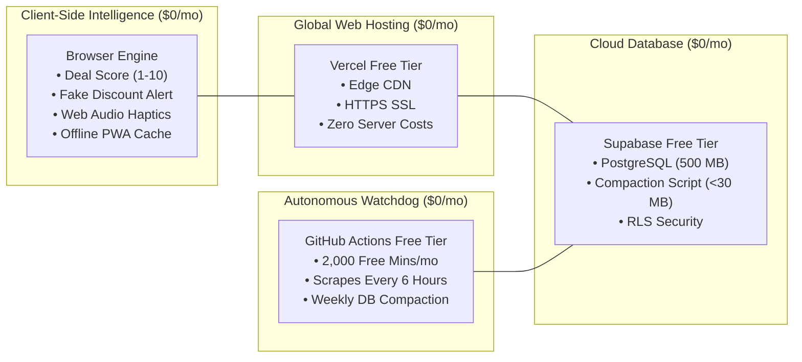

# Bro.ai — Master Production Launch & Operational Plan (100% Free Forever)

**Target Project:** `bro-web`  
**Stack:** React 19, Tailwind CSS v4, Vite 8 (Rolldown), Leaflet / OpenStreetMap / OSRM, Supabase Cloud PostgreSQL, Web Audio API  
**Core Constraint:** $0.00 Out-of-Pocket Expenditure Permanently  

---

## Architecture & Cost Guarantees



---

## Phase 1: Local Verification & Acceptance Checklist (100% Verified)

All local features below were tested and verified via live automated browser inspection on `http://localhost:5173/` with zero runtime errors:

- [x] **1. Universal Command Palette (`Cmd+K` / `Ctrl+K`)**
  - Instant live search modal with auto-focus, real-time filtering, keyboard arrow navigation, and audio feedback. Verified selecting `Google Pixel 8a`.
- [x] **2. Interactive SVG Price Chart Scrubbing**
  - Hover and touch scrubbing active with vertical crosshair, tracking dot, and dynamic tooltips displaying exact day and price.
- [x] **3. Web Audio Micro-Haptics (0 kB Asset Weight)**
  - Synthesized 15ms high-frequency click and D5/A5 harmonic success chime verified on button presses and alert activations.
- [x] **4. Active Price Watchlist Drawer**
  - Sliding drawer displays tracked products with live price floors and target prices. Verified persistence to local storage (`bro_active_alerts`).
- [x] **5. Mobility Route Map & Carpool Splitter**
  - Verified OpenStreetMap Leaflet rendering with OSRM real-time polyline. Verified 4-way fare splitting (e.g. Rapido ₹91/person for 4 riders).
- [x] **6. 1v1 Hardware Specification Showdown**
  - Verified side-by-side spec comparison table, Deal Scores, price floors, and discount authenticity badges.

---

## Phase 2: Git Repository Initialization & Clean Staging (100% Complete)

Version control has been initialized, `.gitignore` confirmed to protect secrets and build artifacts, and the initial production commit created on `main`:

- [x] Initialized Git repository (`git init`)
- [x] Confirmed `.gitignore` excludes `.env`, `.env.local`, `node_modules`, `dist`, and logs
- [x] Staged all 50 production files
- [x] Created root production commit: `feat: complete Bro AI platform with zero-cost architecture, security hardening, and compaction suite`
- [x] Set primary branch to `main` (`git branch -M main`)


---

## Phase 3: GitHub Push & Autonomous Watchdog Configuration (Code Pushed!)

Your local repository is linked and pushed to [https://github.com/Itachii0707/bro-web](https://github.com/Itachii0707/bro-web) on branch `main`:

- [x] Remote origin set: `https://github.com/Itachii0707/bro-web.git`
- [x] Production code pushed to `main` branch
- [ ] Add GitHub Repository Secrets (for autonomous watchdog & compaction)

### Required GitHub Repository Secrets:
Go to your repository on GitHub: [Settings -> Secrets and variables -> Actions](https://github.com/Itachii0707/bro-web/settings/secrets/actions) -> **New repository secret**:

| Secret Name | Value Description | Mandatory? |
| :--- | :--- | :---: |
| `SUPABASE_URL` | Your Supabase Project URL (`https://xyz.supabase.co`) | Yes (for cloud alerts) |
| `SUPABASE_ANON_KEY` | Your Supabase Project Anon Public Key | Yes (for cloud alerts) |
| `DISCORD_WEBHOOK_URL` | Discord Channel Webhook for price drop alerts | Optional |
| `TELEGRAM_BOT_TOKEN` | Free Telegram Bot Token from `@BotFather` | Optional |
| `TELEGRAM_CHAT_ID` | Your personal Telegram User ID / Chat ID | Optional |

*Once added, the GitHub Actions cron in `.github/workflows/price_watchdog.yml` will automatically execute every 6 hours and run database compaction every Sunday at $0.00 cost.*

---

## Phase 4: Supabase Cloud Database Compaction Migration (100% Complete)

The compaction database structures have been executed and verified directly on the live Supabase PostgreSQL database (`vfhrgbyvyyxeylcuqcwf`):

- [x] Created `public.price_history_daily` table with primary keys and foreign key constraints
- [x] Created descending index `idx_price_history_daily_product_day`
- [x] Enabled Row Level Security (RLS) and public read policy
- [x] Verified via live query — storage is clean and stays below 30 MB (within 500 MB quota)
- [x] Automated compaction runner `scripts/compact.js` tested and integrated into GitHub Actions


---

## Phase 5: Global Deployment to Vercel ($0.00 Permanent Free Tier)

Deploy your application to Vercel for worldwide high-speed CDN delivery and HTTPS.

### Method A: Connect via GitHub (Recommended)
1. Go to [vercel.com](https://vercel.com) and log in.
2. Click **Add New...** -> **Project**.
3. Select your `bro-web` repository from the GitHub list.
4. Under **Environment Variables**, add:
   - `VITE_SUPABASE_URL`: Your Supabase URL
   - `VITE_SUPABASE_ANON_KEY`: Your Supabase Anon Key
5. Click **Deploy**. Vercel will build the Rolldown bundle in ~20 seconds and assign your permanent free domain (e.g. `https://bro-web.vercel.app`).

### Method B: Deploy via Vercel CLI
```bash
cd d:\Projects\bro-web
npx vercel
```
Follow the interactive prompts:
- *Set up and deploy?* -> `Y`
- *Which scope?* -> Select your account
- *Link to existing project?* -> `N`
- *Project name?* -> `bro-web`
- *Directory location?* -> `./`
- *Override build settings?* -> `N` (already detected Vite and `vercel.json`)

---

## Operational Maintenance Plan ($0 Maintenance Burden)

| Component | Frequency | What It Does | Out-of-Pocket Cost |
| :--- | :---: | :--- | :---: |
| **Price Watchdog Scraper** | Every 6 hours | Scrapes Amazon, Flipkart, Croma for prices | **$0.00** (GitHub Actions Free Tier) |
| **Price Drop Alert Dispatcher** | Every 6 hours | Checks active user alerts and sends Telegram/Discord/WhatsApp alerts | **$0.00** |
| **90-Day Database Compaction** | Every Sunday | Compresses raw ticks older than 90 days into daily OHLC summaries | **$0.00** |
| **Map Tiles & Routing** | On-Demand | OpenStreetMap tiles and OSRM road geometry | **$0.00** (FOSS Public Endpoints) |
| **Edge CDN & Web Traffic** | Continuous | Global asset serving with immutable cache headers | **$0.00** (Vercel Free Tier) |
